# Administrator guide

**For:** the people who run the application. Administrators can change everything: the framework, the proficiency scale,
teams, roles and their required levels, employees, cycles and assessments. Every change is recorded in the **Audit log**.

All admin pages are under **Admin** in the top menu. The admin menu at the top of each admin page links to every section.

## Checklists

**Starting a new assessment cycle**

1. **Cycles**: create the cycle (e.g. *2028 Annual*). It becomes the active cycle.
2. **Teams & roles**: check that required levels are up to date and validated by management.
3. **Employees**: check new joiners, leavers (deactivate), role and manager changes.
4. Tell employees the cycle is open and share the app link and the [Employee guide](employee.md).
5. Follow progress in **Assessments** or **Gap reports**.

**Onboarding a new team:** see [Onboard a new team](#onboard-a-new-team).

## Overview

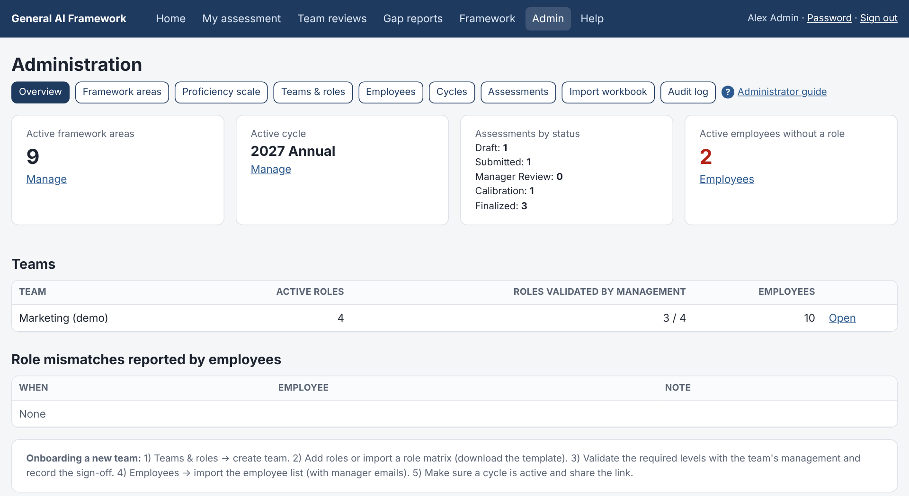

- **Active framework areas**, **active cycle**, **assessments by status** and **employees without a role**
  (they cannot start an assessment; give them a role).
- **Teams** with how many roles have been **validated by management**.
- **Role mismatches reported by employees**: correct the person's role in **Employees**.

## Framework areas

**Admin → Framework areas** lists all areas (K…, S…, C…).

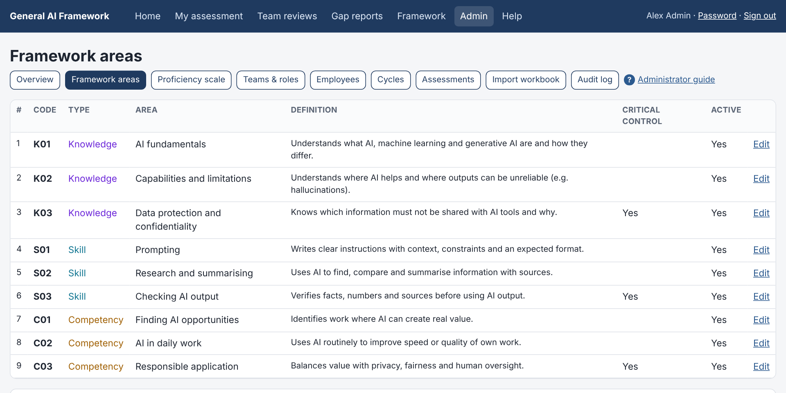

Click **Edit** to change an area:

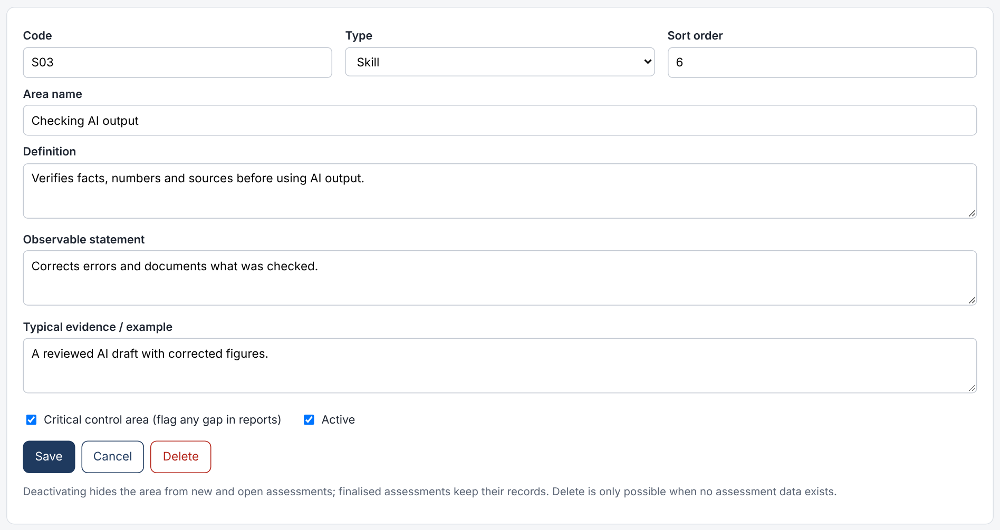

- **Code, type, name, definition, observable statement, typical evidence**: shown to employees on the assessment page.
- **Critical control area**: any gap in this area is flagged in results and reports.
- **Active**: untick to retire an area. It disappears from new and open assessments, and finalised assessments keep their history.
- **Delete** is only possible if no assessment data exists for the area.

**Add an area** at the bottom of the list. A new area has required level 0 for every role; set the levels in the
[requirement matrix](#roles-and-required-levels).

**Evidence guidance by type** (bottom of the page) is the text shown above the Knowledge, Skill and Competency sections of the assessment.

## Proficiency scale

**Admin → Proficiency scale**: the label, the Knowledge / Skill / Competency descriptions and the job-description wording for levels 0–4.
The descriptions appear on the level cards employees click.

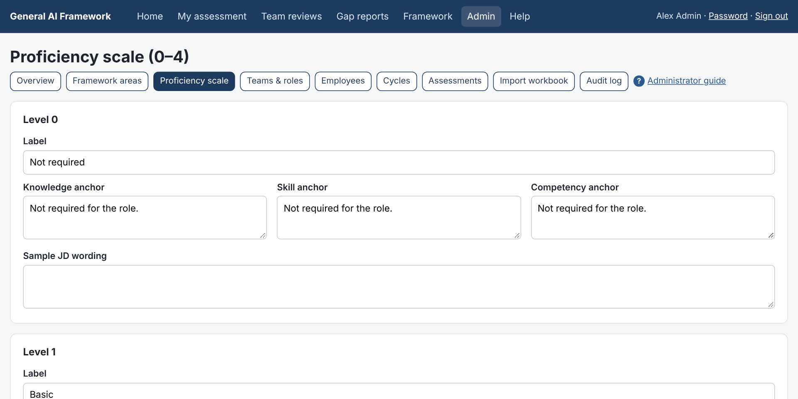

## Roles and required levels

**Admin → Teams & roles** lists teams. Open a team to manage its roles:

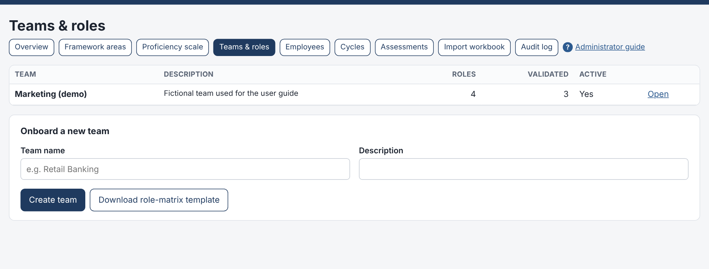

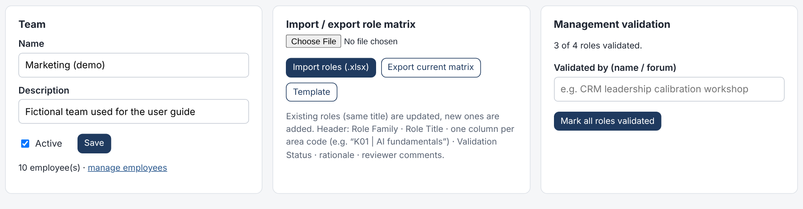

### The requirement matrix

Each row is a role, each column an area. Choose the required level 0–4 in each cell and click **Save matrix**.
Hover over a column header to see the full area name.

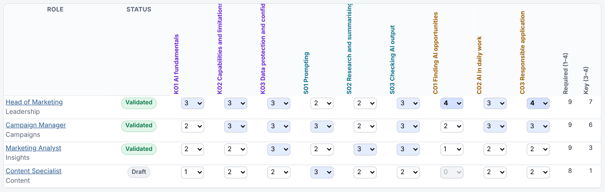

- Open (not finalised) assessments pick up changes immediately.
- Finalised assessments keep the levels they were validated against.
- **Export current matrix** downloads the matrix to Excel. Edit it there and **Import roles (.xlsx)** to upload it again.
  Existing roles (same title) are updated and new ones added.

### Add or edit a role

**Add a role** at the bottom of the team page:

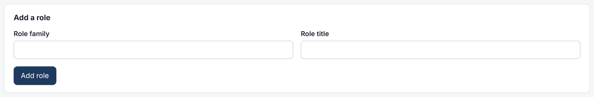

Click a role title in the matrix to edit it:

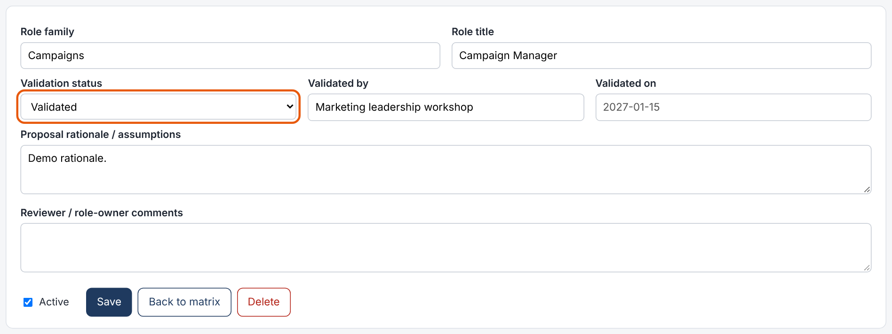

- **Validation status**: *Draft — title-based proposal* → *In review with management* → **Validated**.
  Until a role is validated, employees and managers see a warning that the requirements are a proposal.
- **Validated by**: who approved the levels (e.g. *CRM leadership workshop*). The date is set automatically.
- **Rationale** and **reviewer comments** document why levels were chosen.
- Untick **Active** to retire a role. **Delete** only works if no employees or assessments use it.

### Record management sign-off

After the required levels have been agreed with the team's management, use **Management validation → Mark all roles validated**
on the team page, with the name of the forum or person that approved them.

## Employees

**Admin → Employees**: filter by team, search, and edit people.

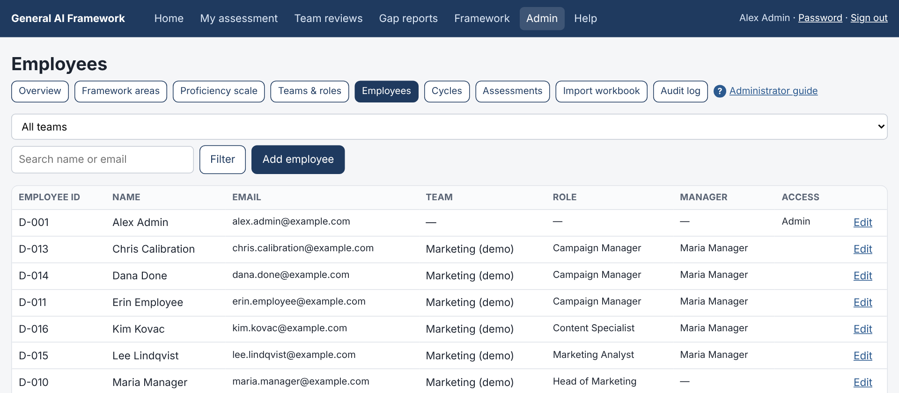

**Add employee** or click **Edit**:

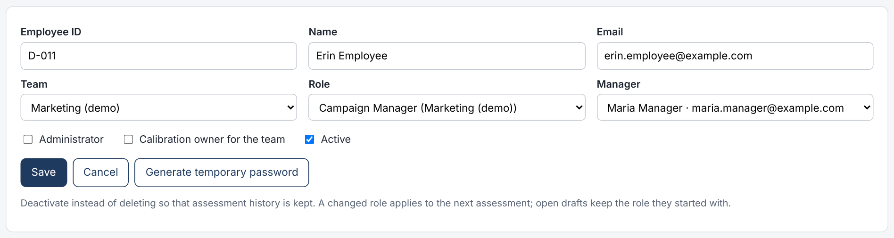

- **Team** and **Role** decide which areas and required levels apply. **Manager** decides who reviews the assessment.
- **Administrator**: full access to Admin. **Calibration owner for the team**: can calibrate and report on the whole team.
- **Active**: untick for leavers. Their history is kept. Don't delete people.
- **Generate temporary password** if someone forgot theirs.

New accounts and password resets show a **temporary password once**. Pass it on securely (not in a group chat).
The user must choose their own password at first sign-in.

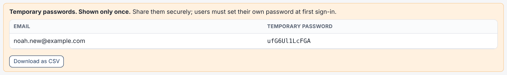

### Bulk import

**Bulk import employees** at the bottom of the Employees page accepts .xlsx or .csv (**Download template**):

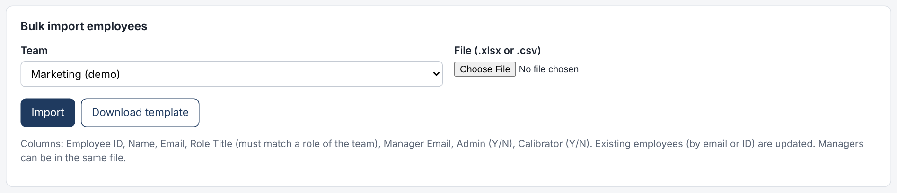

| Column | Notes |
|---|---|
| Employee ID | Stable HR ID (required) |
| Name, Email | Required. Email is the login. |
| Role Title | Must match a role of the selected team exactly |
| Manager Email | The manager can be in the same file or already exist |
| Admin, Calibrator | Y / N |

Existing people (same email or employee ID) are updated, not duplicated. After the import you see the temporary
passwords of new accounts once. Use **Download as CSV** to keep them for distribution, then delete the file.

## Onboard a new team

1. **Teams & roles → Onboard a new team**: enter the team name and click **Create team**.
2. **Download role-matrix template**, fill in the team's roles and required levels (0–4 per area) together with the team's
   management, then **Import roles (.xlsx)** on the team page. Or add roles one by one and fill in the matrix.
3. Agree the levels with management and **record the sign-off** (Validated).
4. **Employees → Bulk import**: select the new team and upload the employee list.
5. Check **employees without a role** on the Overview, then share the app link and the guides.

## Cycles

**Admin → Cycles**: only one cycle is active at a time. **Create cycle** makes the new cycle active. **Close** / **Make active** switch it.
Employees always work in the active cycle, and earlier cycles stay available in history and reports.

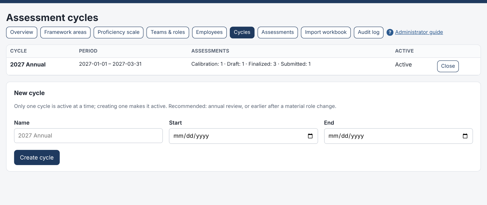

## Import the framework workbook

**Admin → Import workbook** reads a workbook in the layout of the original framework file: the sheets *General AI Framework*,
*Proficiency Scale* and a role matrix (*… KSC Role Rating*). Choose what to import and the team for the role matrix.
The import is repeatable: it updates by area code and role title and never deletes.

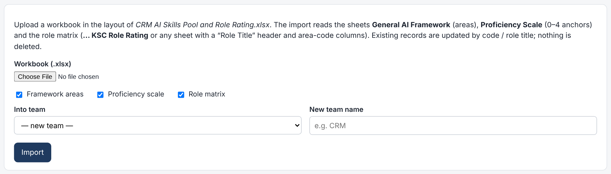

## Assessments

**Admin → Assessments** lists all assessments with filters by cycle and status. **Open** goes to the review page, where admins
can also review, calibrate, finalise and reopen. **Delete** permanently removes an assessment. Use it only for test entries.

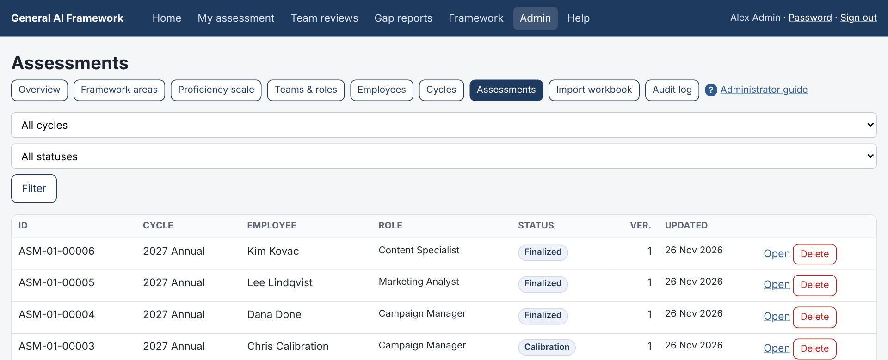

## Audit log

Every sign-in and every change (framework, roles, matrix, employees, imports, submissions, reviews, finalisations, reopenings,
exports) is recorded with the time and user.

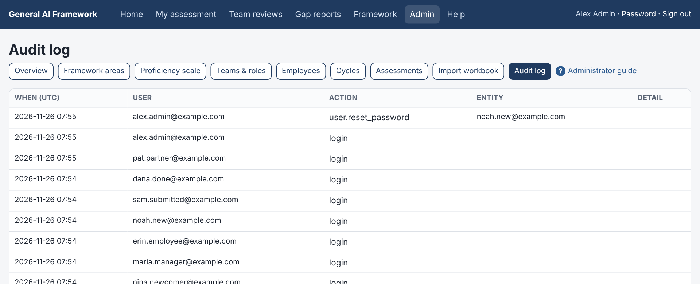

## Good practice

- Treat assessment data and exports as confidential employee information.
- Retire (deactivate) instead of deleting areas, roles and people, so history stays consistent.
- Change required levels before a cycle starts, not in the middle of it.
- When the app changes, the guide must change too. See [MAINTAINING.md](MAINTAINING.md).
