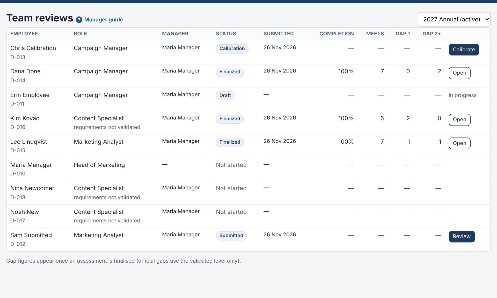
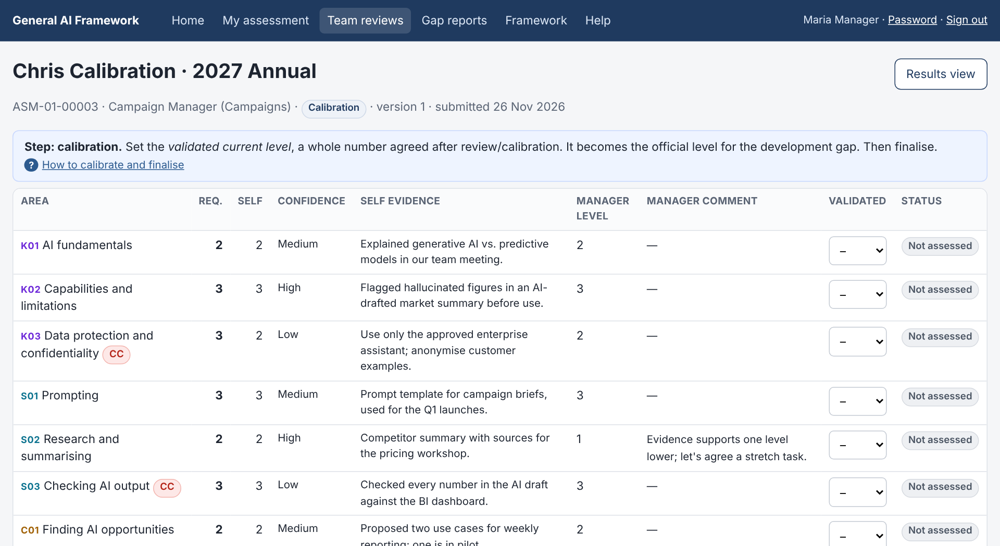

# Calibration owner guide

**For:** colleagues from People & Culture, Learning & Development or team leadership who make sure validated levels are
**consistent across a whole team**. An administrator gives you this role (*Calibration owner for the team*).

## What you can do

| | Line manager | Calibration owner |
|---|---|---|
| See assessments | Direct reports | **Everyone in your team** |
| Manager review (manager level + comments) | ✔ | — (the line manager's task) |
| Set validated levels, finalise | Direct reports | **Everyone in your team** |
| Return / reopen an assessment | Direct reports | **Everyone in your team** |
| Gap reports and Excel export | Direct reports | **Whole team** |

## What you need to do

1. Track progress in **Team reviews**: who has not started, who is waiting for a manager review, what is ready for calibration.
2. Prepare and run calibration sessions with the managers.
3. Set or correct validated levels and finalise, or let managers do it after the session.
4. Use **Gap reports** to propose team learning priorities.

## Track progress

**Team reviews** shows every member of your team with their manager and status:

Remind employees in *Not started* / *Draft*, and managers whose team members are in *Submitted* / *Manager Review*.
You can open an assessment in the manager review step to read it, but only the line manager enters manager levels.

## Run a calibration session

The aim is that the same evidence leads to the same level, whichever manager assesses it.

1. Before the session: export the data (**Gap reports → Export to Excel**). Filter the *Employee Assessment* sheet to records in
   *Calibration*, and look at areas where manager and self levels differ or where level 4 was given.
2. In the session: walk through those cases by area, compare the evidence with the
   [scale and evidence expectations](employee.md#step-3-add-evidence), and agree the level.
3. Record the agreed level as the **validated level** on the review page and finalise:

Rules of thumb:

- Don't average. Choose the whole level the evidence supports.
- A course alone supports Knowledge, not Skill or Competency.
- Level 4 needs evidence of standard-setting, leading others or organisational impact.
- Pay extra attention to **critical control areas** (marked **CC**).

## Reports

**Gap reports** for your team work as described in the [Manager guide](manager.md#using-the-gap-reports).
Use **Most common gaps** and **Team gap by area** to propose learning interventions, and **By role family** to compare groups.

## Correcting a finalised result

Use **Return to employee / reopen** with a reason (see the [Manager guide](manager.md#returning-an-assessment-or-reopening-it)).
The version number increases and the change is logged.
