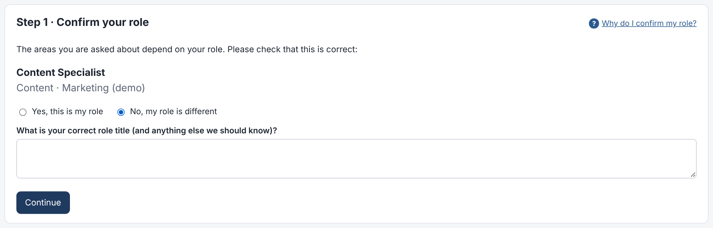
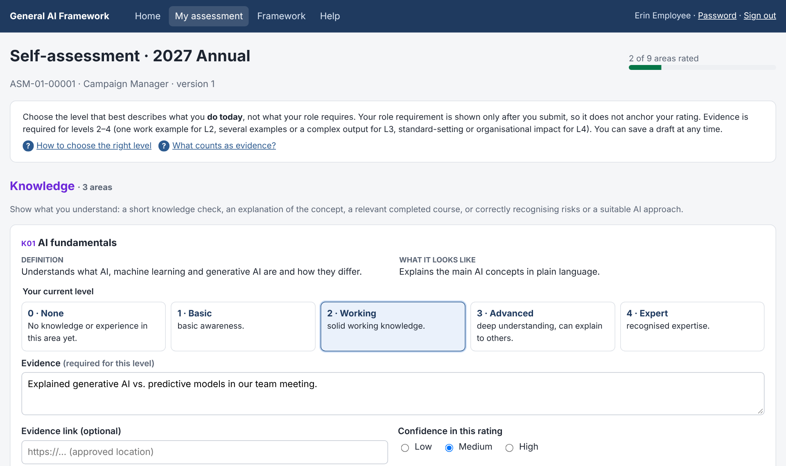
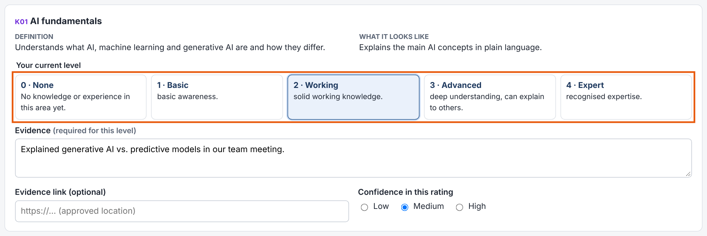
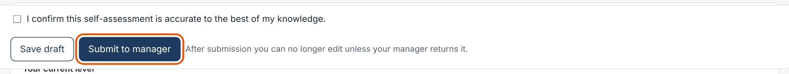
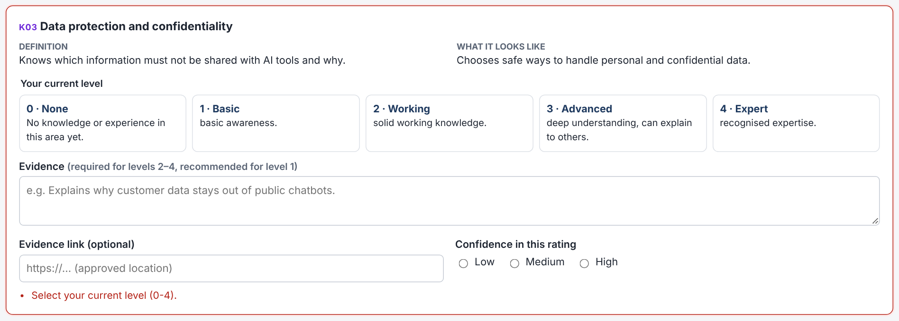
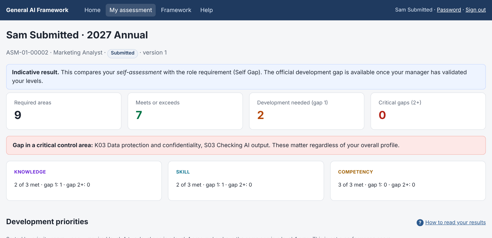
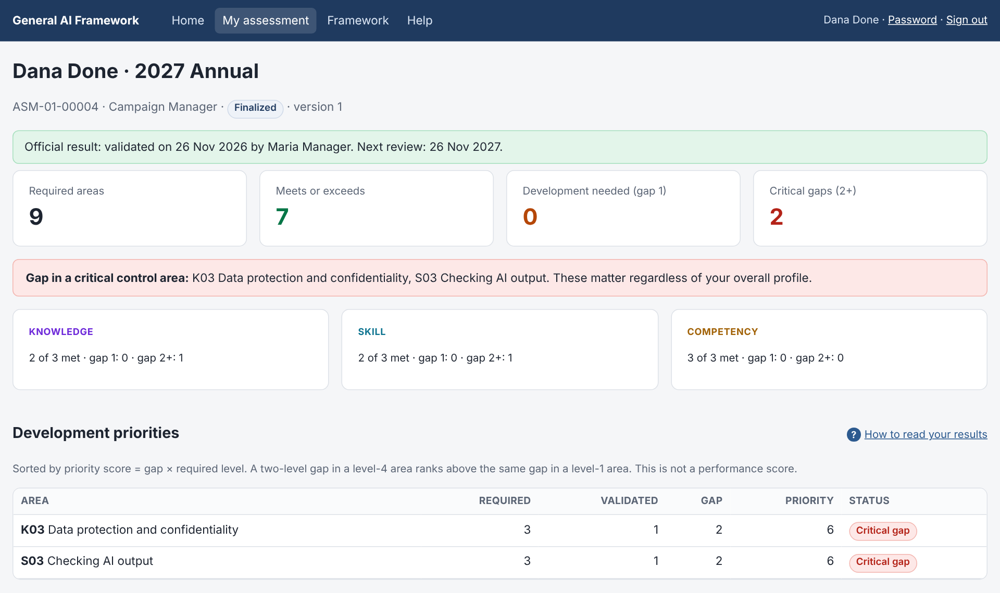
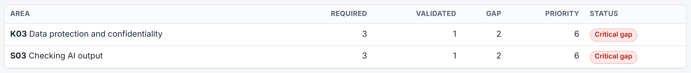

# Employee guide

**For:** every employee who has been asked to complete the AI self-assessment.

**Time needed:** about 20–30 minutes. You can save and continue later.

## What you need to do

1. Confirm your role.
2. Rate your current level in each area your role requires.
3. Add evidence for levels 2–4.
4. Submit to your manager.
5. Discuss the result with your manager and read your official result once it is finalised.

## Before you start

- Rate what you **do today**, not what you think your role expects. The required level for your role is hidden
  while you rate, so it doesn't steer your answer.
- Have a few concrete examples from your recent work ready (prompts, analyses, documents, process changes).
- **Never paste confidential, customer or personal data** into the app. Describe the example and, if needed,
  add a link to an approved location (SharePoint, Teams…).

## Step 1: Confirm your role

Open **My assessment** (or **Start self-assessment** on the Home page). The app shows the role you are assigned to.
The areas you will be asked about depend on this role.

- If it is correct, keep **Yes, this is my role** and click **Continue**.
- If it is wrong, choose **No, my role is different**, write your correct role title and click **Continue**.
  The administrator is notified and corrects it. Start the assessment once your role has been fixed.

## Step 2: Rate your current level

The assessment shows only the areas your role requires, grouped into **Knowledge**, **Skill** and **Competency**.
The bar in the top-right corner shows how many areas you have rated.

For each area:

1. Read the **Definition** and **What it looks like**.
2. Click the level card that best describes you **today**. The text on each card explains the level for this type of area.

**How to choose the right level**

- If you are between two levels, choose the **lower** one and explain in the evidence what you already do towards the higher level.
- **Level 4 (Expert)** means you set standards, lead others or shape practice in the organisation.
  Being a very good, frequent user is usually level 2 or 3.
- **Level 0** is fine. It simply means you have no experience in that area yet.

## Step 3: Add evidence

Evidence is **required for levels 2–4** and recommended for level 1. The hint next to *Evidence* tells you when it is required,
and the field shows an example of typical evidence for the area.

| Type | Good evidence | Not enough on its own |
|---|---|---|
| Knowledge | You can explain the concept; a knowledge check; a relevant course; you recognised a risk | — |
| Skill | Something you produced: a prompt, an AI-assisted analysis, a checked AI draft, an automation | A completed course |
| Competency | Application in your work: a use case, a changed process, a measured benefit, a control you introduced | A completed course, a one-off try |

How much evidence:

| Level | Expected evidence |
|---|---|
| 1 | A simple example or confirmation |
| 2 | At least one example from your work |
| 3 | Several examples, or one documented complex output |
| 4 | Evidence that you set standards, lead others or had organisational impact |

Also choose your **confidence** in each rating (Low / Medium / High). It helps your manager decide where to focus
the conversation and does not change your score. The **evidence link** is optional and must start with `https://`.

## Step 4: Save or submit

At the bottom of the page:

- **Save draft** keeps your answers. You can leave and continue later via **Home → Continue**.
- **Submit to manager**: tick *I confirm this self-assessment is accurate…* and click **Submit to manager**.

If something is missing, the page tells you how many items need attention and highlights them in red with an explanation:

Typical reasons: no level selected, no evidence for level 2–4, no confidence selected, an invalid link, or the confirmation box not ticked.

> After you submit, the assessment is **locked**. If you need to change something, ask your manager to return it to you.

## Step 5: Wait for your manager's review

Your manager reviews your ratings and evidence, adds their own view, and agrees the **validated level** with you,
usually in a short conversation. If your manager returns the assessment to you, it appears as **Draft** again on your
Home page. Update it and submit again.

## Step 6: Read your results

**Right after submitting** you see an **indicative result**. It compares your *self-rating* with the role requirement
(the *Self Gap*). This is only a first indication.

**After your manager finalises** the assessment, you see your **official result** based on the validated level:

- **Required areas / Meets or exceeds / Development needed / Critical gaps** summarise your profile.
- A red banner appears if you have a gap in a **critical control area** (for example data protection or checking AI output).
  These matter even if the rest of your profile is strong.
- The **Knowledge / Skill / Competency** cards show each type separately. There is no single overall score.

**Development priorities** list your gaps, most important first:

The *priority* is the gap multiplied by the required level, so a gap in an area that matters a lot for your role ranks higher.
It is a planning aid, **not a performance score**. Use the list to agree learning actions with your manager.

The table **All areas** below shows every area with the required, self, manager and validated levels, the gap, any
surplus (levels above the requirement) and your evidence.

> A yellow banner "Role requirements not yet validated" means management has not yet confirmed the required levels for your role.
> Your gaps may still change.

## Previous cycles

Assessments from earlier cycles stay available under **Previous assessments** on your Home page.

## Need help?

See the [FAQ](faq.md) or contact your administrator.
