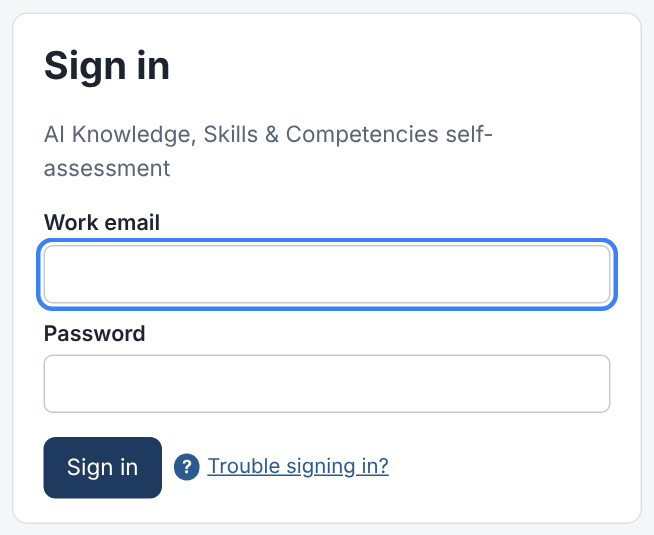
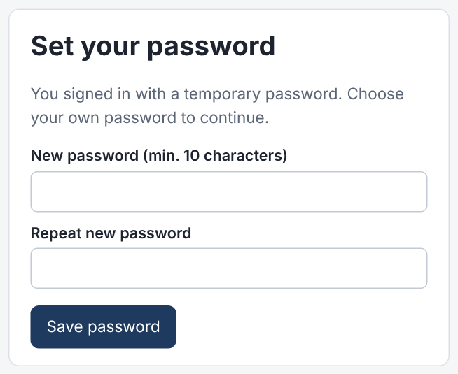
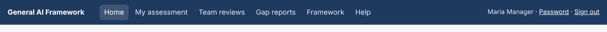
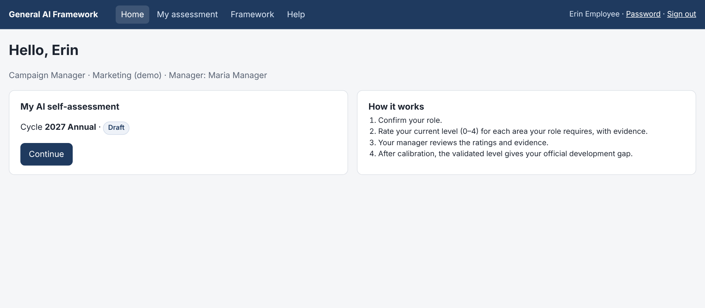
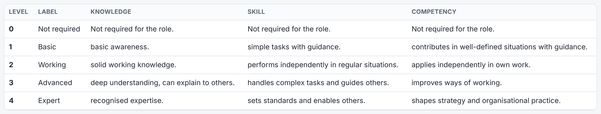
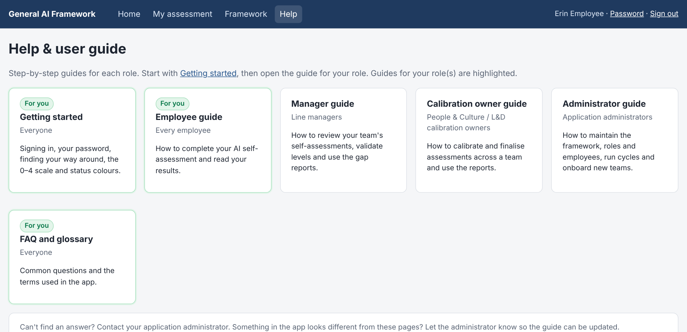

# Getting started

This app is used to assess **AI Knowledge, Skills and Competencies** against what your role requires.
You rate your current level, your manager reviews it, and the app shows where you meet the requirement and
where you can develop.

> Screenshots in this guide show fictional demo data. Your areas, roles and names will be different.

## Signing in

1. Open the app link you received from your administrator.
2. Enter your **work email** and the **temporary password** you were given, then click **Sign in**.

### Set your own password

At your first sign-in you are asked to choose your own password (at least 10 characters). Enter it twice and click
**Save password**. You can change it later via **Password** in the top-right corner.

**Forgot your password?** Ask your administrator. They generate a new temporary password for you.

You are signed out automatically after 8 hours. Use **Sign out** in the top-right corner on shared computers.

## Finding your way around

The menu at the top shows only what your role can use:

| Menu item | Who sees it | What it is for |
|---|---|---|
| **Home** | everyone | Your status and next step |
| **My assessment** | everyone | Your own self-assessment and results |
| **Team reviews** | managers, calibration owners, admins | Assessments of the people you review |
| **Gap reports** | managers, calibration owners, admins | Team results and Excel export |
| **Framework** | everyone | All areas, definitions and the proficiency scale |
| **Admin** | administrators | Maintaining the framework, roles, employees and cycles |
| **Help** | everyone | This guide |

The **Home** page always tells you what to do next, for example **Start self-assessment** or **Continue**:

Look for the **?** links on the pages. They open the relevant part of this guide.

## The framework in one minute

Areas are grouped into three types:

| Type | Question it answers | Good evidence |
|---|---|---|
| **Knowledge** (K…) | What do you know and understand? | Explaining a concept, a knowledge check, recognising risks |
| **Skill** (S…) | What can you do? | An output you produced with AI: a prompt, an analysis, a checked draft |
| **Competency** (C…) | Do you apply it effectively in your work? | A use case, a process change, a measured benefit |

## The 0–4 scale

Every area is rated on the same scale. The wording on the level cards is adapted to Knowledge, Skill or Competency.

| Level | Label | In short |
|---|---|---|
| 0 | None / Not required | No experience yet, or not needed in the role |
| 1 | Basic | Simple situations, with guidance |
| 2 | Working | Independent in everyday work |
| 3 | Advanced | Complex situations, improves practice, guides others |
| 4 | Expert | Sets standards and direction for others |

The full descriptions are on the **Framework** page:

## Status colours

| Status | Meaning |
|---|---|
| 🔴 **Critical gap** | Two or more levels below the requirement: a priority development area |
| 🟠 **Development needed** | One level below the requirement |
| 🟢 **Meets requirement** | At the required level |
| 🔵 **Exceeds requirement** | Above the required level |
| ⚪ **Not assessed** | No validated level yet |
| ⚪ **Not required** | The role does not need this area |

Statuses are always written out in text, so you don't need to rely on colour.

## Where to go next

- Everyone: [Employee guide](employee.md)
- Line managers: [Manager guide](manager.md)
- Calibration owners: [Calibration owner guide](calibration.md)
- Administrators: [Administrator guide](admin.md)
- Questions: [FAQ and glossary](faq.md)
