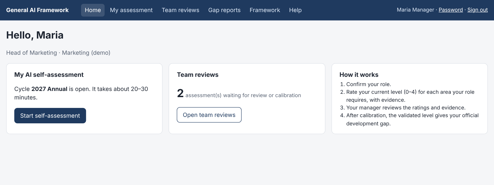
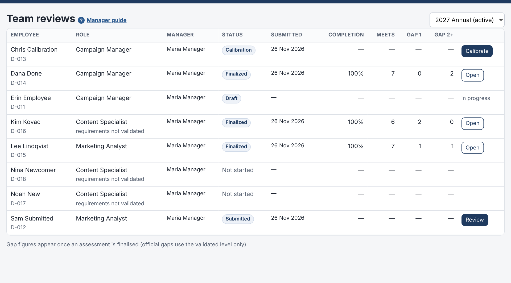
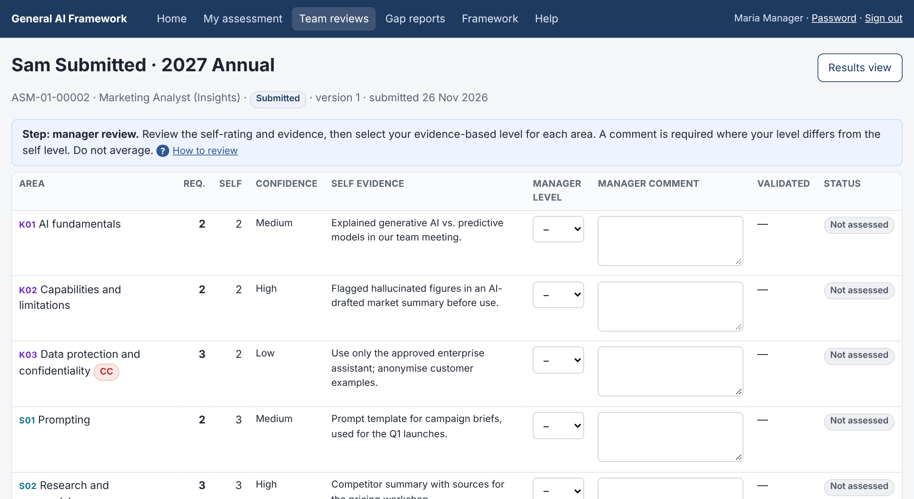
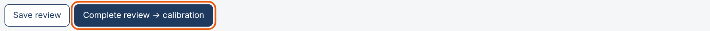
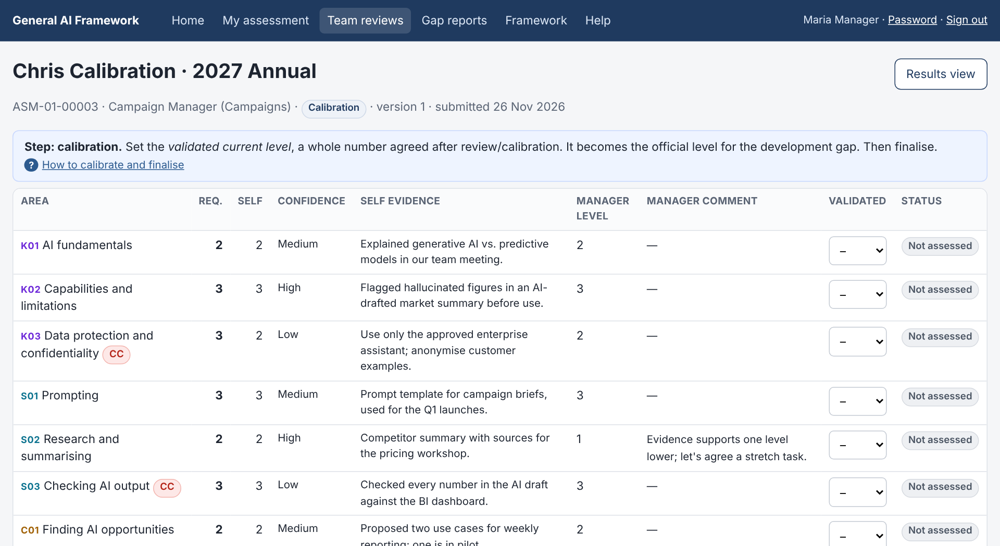
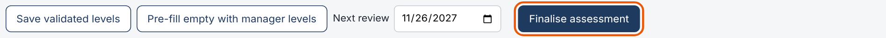
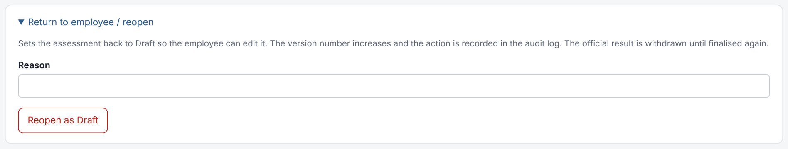
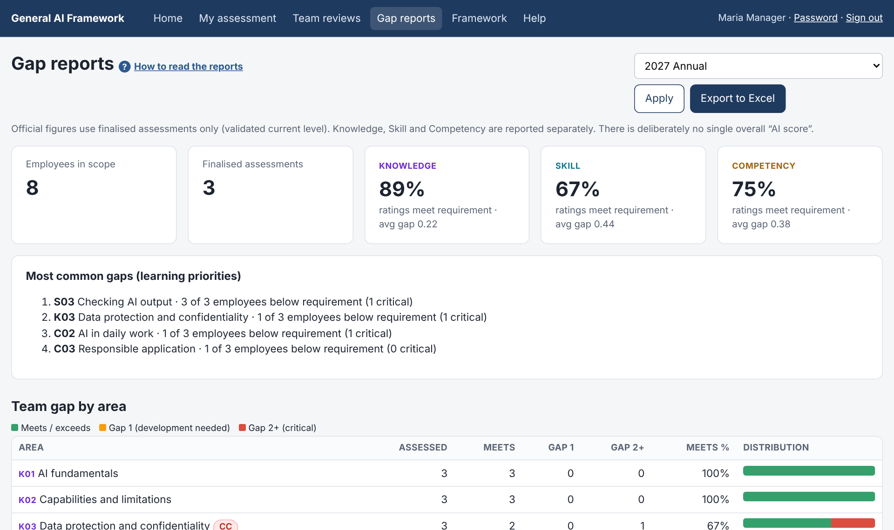
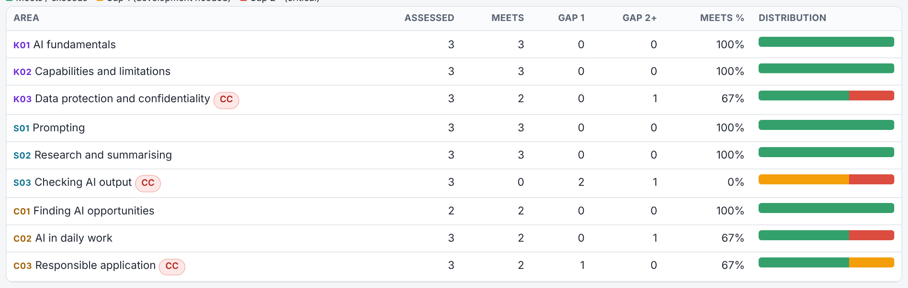
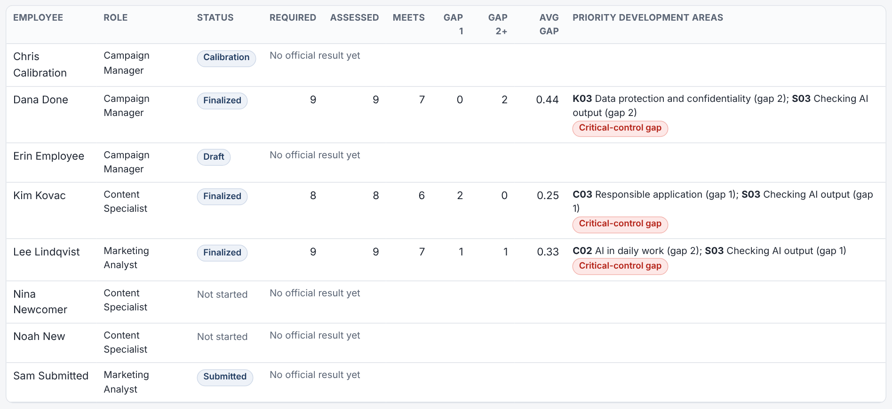

# Manager guide

**For:** line managers whose team members complete the AI self-assessment.
You review the self-ratings and evidence, decide on an evidence-based level, agree the **validated level**, and finalise the assessment.
Your own self-assessment works exactly as described in the [Employee guide](employee.md); it is reviewed by your own manager.

## What you need to do

1. Check **Team reviews** for submitted assessments.
2. **Review:** give your manager level for each area and comment where you disagree.
3. **Calibrate:** agree and set the validated level, then **finalise**.
4. Discuss the development priorities with each team member.
5. Use **Gap reports** to plan team learning.

## Your Team reviews page

**Home** shows how many assessments are waiting for you. **Team reviews** lists all your direct reports for the selected cycle:

| Status | What it means | Your action |
|---|---|---|
| *Not started* | The employee has not opened the assessment yet | Remind them if needed |
| **Draft** (*in progress*) | The employee is still working on it | None yet |
| **Submitted** | Ready for your review | Click **Review** |
| **Manager Review** | You have started reviewing | Click **Review** to continue |
| **Calibration** | Your review is complete; validated levels needed | Click **Calibrate** |
| **Finalized** | Official result published | **Open** to see it |

Use the cycle selector in the top-right corner to look at earlier cycles.

## Step 1: Review the self-assessment

Open an assessment with **Review**. For each required area you see the **required level**, the employee's **self level**,
their **confidence** and **evidence**.

For each area:

1. Read the evidence. Open the evidence link if there is one.
2. Select your **manager level** (0–4), based on what you have observed and the evidence.
3. If your level is **different from the self level, a comment is required.** Explain why and, ideally, what would show
   the higher level. The employee sees your comment once the assessment reaches calibration.

Good practice:

- Judge the evidence, not the person's confidence or seniority.
- Don't average. If the self level is 3 and you see 2, choose 2 or 3 and explain why. Values like 2.5 have no meaning on the scale.
- Level 4 is rare: it requires standard-setting or organisational impact.
- Areas marked **CC** are critical control areas, such as data protection or checking AI output. Pay particular attention to them.

At the bottom: **Save review** saves your progress. **Complete review → calibration** checks that every area has a manager
level and that differences have comments, then moves the assessment to *Calibration*.

## Step 2: Calibrate and finalise

In the *Calibration* step, set the **validated current level** for each area. This is the official level used for the
development gap. Agree it with the employee in a short conversation, or in a team calibration session with your
calibration owner (People & Culture / L&D).

- **Save validated levels** saves your progress.
- **Pre-fill empty with manager levels** copies your manager level into empty validated fields as a starting point. Review them before finalising.
- **Next review** is set to 12 months by default. Choose an earlier date, for example after a role change.
- **Finalise assessment** publishes the official result to the employee and to the gap reports. Every area needs a validated level.

After finalising, discuss the **development priorities** with the employee and agree 1–3 concrete actions
(practice on real work, a stretch task, a course, coaching).

> The status column shows the effect immediately: 🔴 *Critical gap* (2+ levels below), 🟠 *Development needed* (1 below),
> 🟢 *Meets*, 🔵 *Exceeds*. A surplus in one area never offsets a gap in another.

## Returning an assessment or reopening it

Use **Return to employee / reopen** at the bottom of the review page. You can use it when the employee should correct their
self-assessment, or when a finalised result must change (for example after a role change). Enter a reason and click **Reopen as Draft**.

The assessment goes back to **Draft**, the version number increases, and the change is recorded in the audit log.
A finalised result is withdrawn until it is finalised again.

## Using the gap reports

**Gap reports** summarises the **finalised** assessments of your team. Assessments still in progress are not counted.

- The top cards show how many employees are in scope and finalised, and the share of ratings meeting the requirement for
  **Knowledge**, **Skill** and **Competency** separately.
- **Most common gaps** lists the areas where most people are below the requirement. These are good candidates for team learning.
- **Team gap by area** shows, per area, how many people meet the requirement, have a gap of 1, or a gap of 2+:

- **By role family** and **By role** show the same for groups of roles.
- **Employee gap summary** lists each person with their counts, average gap, critical-control flags and top priorities:

**Export to Excel** downloads everything: one row per employee and area (with self, manager and validated levels, gaps and
evidence) plus the summary sheets. Handle the file as confidential employee data.

## Need help?

See the [FAQ](faq.md) or contact your administrator.
